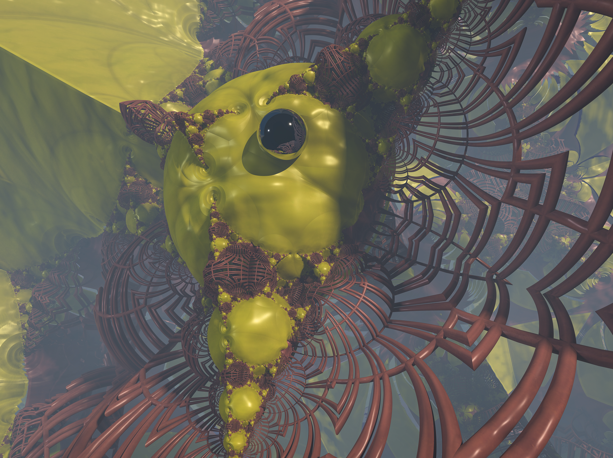
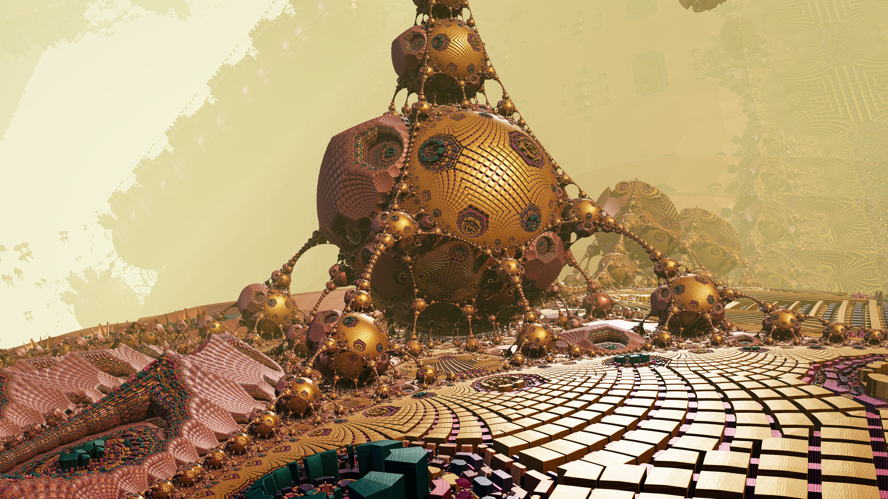

# NOEMA Fractal

**Create and explore 3D fractal artwork.**

**[Official website](https://patrickkarlsson.se/program)**

NOEMA Fractal is an open-source Windows application for exploring fractal formulas, shaping materials and lighting, and rendering still images. It uses WebGPU for interactive previews and final rendering.



*Artwork created with NOEMA Fractal. Artwork © 2026 Patrick Karlsson. All rights reserved.*

## Windows 1.0

Download **NOEMA-Fractal-1.0-windows-x64.zip** from the project's Releases or SourceForge Files page. Extract the complete archive to a writable folder and run **Start-NOEMA-Fractal.cmd**. A new, empty `Profile` folder is created beside the launcher. Read [Start here](docs/START_HERE.md) and [Known limitations](docs/release/1.0/KNOWN-PROBLEMS.md).

Windows x64 and a working WebGPU graphics driver are required. GPU testing has been performed on an NVIDIA RTX 2080; other GPUs have not been qualified. The portable executable is not code-signed. Rendering works locally. Optional AI and online material features require a connection and your own provider credentials where applicable.

## Tools for making images

- Fractal formulas and formula chains, with author credits.
- Interactive camera, materials, lights, atmosphere and color gradients.
- Progressive previews and still image rendering.
- Scene saving, local libraries and open-format export.
- Optional AI assistance; your own credentials and explicit use are required.



*Artwork created with NOEMA Fractal. Artwork © 2026 Patrick Karlsson. All rights reserved.*

## Build from source

Use Node.js 24 and npm on Windows. Install the locked dependencies, then build:

```sh
npm ci
npm ci --prefix tools/noema-mcp
npm ci --prefix tools/openai-pilot
npm test
npm run build
npm run desktop:build
npm run desktop:start
npm run desktop:pack
```

The portable folder is written to `release/NOEMA-Fractal-1.0`. The package builder accepts only program files and dependencies; no personal profile, example scene or external resource folder is copied. The offline manual is available through **Help → User manual**. The included automated tests use mathematical examples generated in code, with no saved personal scenes.

## License

Program code: [Apache-2.0](LICENSE). Documentation, original gradients and formula explanatory prose: [CC BY 4.0](LICENSES/CC-BY-4.0.txt). [Formula credits](CREDITS.md) and [third-party notices](THIRD_PARTY_NOTICES.md) are retained.

**Artwork © 2026 Patrick Karlsson. All rights reserved.** The presentation images are excluded from the open-source licenses. See [license scope](LICENSING.md).
